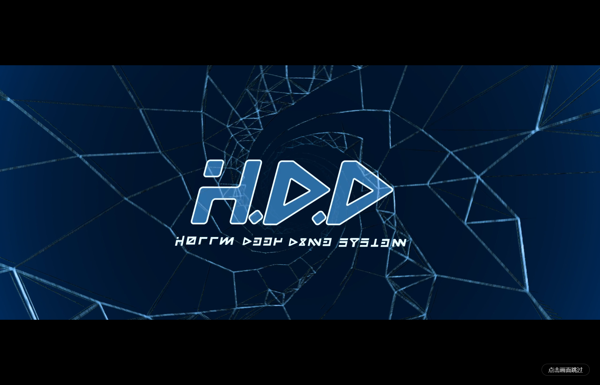

# dsh-boot-video

**给 DeepSeek Harness（DSH）加一段视频开机片头。**
启动客户端时全屏播放你的 mp4，播完淡出、露出真正的界面；点击画面或按 `Esc` 随时跳过。

*Full-screen video boot splash for DSH.*

[](https://www.npmjs.com/package/dsh-boot-video) [](https://github.com/xufu5438-netizen/dsh-boot-video)



---

## 特性

- 🎬 **一段 mp4 = 一次开机片头**：全屏播放，播完淡出进界面，不是"加载完成就切走"
- ⏭️ **随时跳过**：点击画面或按 `Esc`
- 🔊 **桌面版直接带着声音播出**（Electron 默认允许未静音自动播放）；网页版会被浏览器拦下，于是自动降级成静音并亮出「打开声音」按钮（点它只开声、不跳过）
- 🖥️ **盖住 DSH 自己的开机卡片**：首帧由宿主半边在文档解析阶段注入，`HARNESS / Loading plugins…` 不会露脸
- 🔀 **不跟别的片头插件打架**：各写自己的 localStorage 键，同时装也不会互相干扰
- 🖼️ **不裁画面**：始终按完整比例居中显示；片源自带的那圈黑边在压制素材时就裁掉了
- 📦 **零运行时依赖**：宿主半边只用 `node:` 内建模块，浏览器半边只有一条 `<video>`
- ⚙️ **设置单开一页**：设置侧边栏里的「开机动画」，开关 / 素材 / 预览都在那儿，不挤在「通用设置」里
- 🩺 **自检行**：设置页底部写着"客户端半边是什么时候加载的、上次开机到底播成功没有"——
  改了没生效 / 视频打不开，看一眼就知道
- 🔄 **导入的视频会自动转码**：解不了的编码（典型是 HEVC / H.265）不用你自己动手转——
  插件自己下 ffmpeg（国内镜像）转成 H.264 再收下，转完先验一遍能不能播

## 安装

```sh
# 从 npm 安装（推荐）
dsh plugin --profile web add dsh-boot-video

# 从 GitHub 安装（仓库带构建产物，没有安装期脚本，不触发构建授权）
dsh plugin --profile web add github:xufu5438-netizen/dsh-boot-video

# 或从本地目录安装（把路径换成你解压出来的目录）
dsh plugin --profile web add <本目录绝对路径>
```

装完**必须重启一次 DSH**（bundle 在启动时装配），然后 **Ctrl+Shift+R** 硬刷新——
DSH 的客户端 bundle 带 `max-age=31536000, immutable`，普通 F5 会一直用第一次抓到的副本。

> **桌面版（Electron）**：也可以在应用里走「设置 → 插件 → 添加插件」贴本目录路径（插件管理器原生支持
> 本地路径 / registry / git / tarball 四种 spec）。桌面版的 index 注入表在宿主启动时收集一次，
> 所以那里装完必须**完全退出并重新打开**，刷新页面不够。

### 卸载

```sh
# 命令行装的
dsh plugin --profile web remove dsh-boot-video
```

桌面版在「设置 → 插件」里点卸载即可。**卸载后开机会恢复成 DSH 自己的启动画面**——
本插件不留下任何全局改动（只写自己那几个 localStorage 键；想彻底还原则在控制台删掉
`dsh-boot-video:source` / `dsh-boot-video:asset` / `dsh-boot-video:last-boot` 三个键）。

### 自己打"发布包"（只带已授权的那段）

```sh
npm run pack:release
```

它会临时把「月读世界」那段从包内容里排除、打完立刻还原清单，并**核对包里到底有什么**
（一旦混进没授权的素材，它会删掉包并以非零码退出）。当前结果：**11.37 MB**，只含
`assets/hdd.mp4` + 代码 + 一张预览图。

## 使用

**设置 → 侧边栏「开机动画」**（0.3.0 起是独立一页，不再挂在「通用设置」里）：

| 控件 | 档位 | 效果 |
|---|---|---|
| 启动时播放 | **我的视频**（默认） | 启动时全屏播一短片头，播完淡出进界面 |
| | **不播放** | 启动直通界面（想恢复：设置页里点回「我的视频」，或在控制台删掉 `localStorage['dsh-boot-video:source']`） |
| 片头素材 | **HDD**（默认） | `assets/hdd.mp4`，10.47 MB |
| | **月读世界** | `assets/yuedu.mp4`，29.01 MB，4K/60fps 重压（CRF 24、PSNR 46.2 dB，肉眼无差） |
| 导入自己的视频 | **⬆ 导入视频** | 挑一段你自己的 mp4（上限 512 MB），存进插件的 `assets/user/`，以后随时能选、能删 |
| 预览 | **▶ 播放一遍** | 不重启就看看效果；正在播时点它会从头重播 |

换素材会立刻用新素材重播一遍——不用为了确认换了没有去重启。

### 导入自己的视频（0.8.0 起默认开启）

点「⬆ 导入视频」挑一段 mp4，它会被**原样存进插件的 `assets/user/`**（不转码、不重封装——
导进去什么样，播出来什么样），然后自动选上、播一遍，**并弹出起名窗口**。这是本插件的主功能之一；
不想让插件能写盘的话，跑 DSH 时设 `DSHBV_IMPORT=0` 就能把它关掉（客户端那侧对应 `IMPORT_ENABLED`）。

- **素材带**里点它 = 换成它；旁边的小「×」= 从插件里删掉这一份（**你自己的原片不受影响**）
- 下面的「我导入的视频」列表负责「改名」与「删除」；改名**只改显示名**（磁盘文件名不动），
  留空 = 回到原始文件名
- 网页版与桌面版都能导，插件内部走的是两条路：
  - **网页版**：文件本体流式传给 DSH（带进度条），宿主边收边写盘
  - **桌面版**：Electron 能把"你刚选的那个文件"翻成绝对路径，于是**宿主直接复制**，几百 MB 也很快；
    这条路不通（旧版 Electron / 跨盘 / 没权限）会自动回退到上传那条
- 想手动清也可以：直接删掉 `assets/user/` 里那几个 `u-*.mp4`（清单是按目录推导的，不会留残影）；
  自定义名字在同目录的 `labels.json` 里，删掉它就全回到原始文件名
- **导入的内容只在你机器上**：发布包里没有别人的视频，别人导入的也不会传到你这儿

#### ⚠️ 只收 **mp4**；编码不支持的**会自动转码**

导入只认 `.mp4`（不是 mp4 会在选择器与本地校验那里就拦住）。至于"里面是什么编码"——
**不用你操心**：

| 你手上的文件 | 会发生什么 |
|---|---|
| `.mp4` + H.264（剪映/手机导出、B 站下载的常见形态） | ✅ 直接导入 |
| `.mp4` + HEVC（不少"4K 片源"） | 🔄 导入时会问一句「要不要自动转换」，点一下插件自己把 ffmpeg 下下来（约 28MB，国内镜像）转成 H.264，转完自动收进素材列表 |
| 其它容器（`.mkv` / `.webm` / `.mov`） | ❌ 被拒；先剪成 mp4（剪映导出选 mp4 + H.264 最省事） |
| 不是视频的文件 | ❌ 被拒（"没找到视频轨"） |

转码用的是 `libx264 -crf 20`、**保持原分辨率与帧率**、音频 AAC 192k、`+faststart`；
转完插件**自己先验一遍能不能播**才收下。命令行等价物（不想用界面时）：

```sh
node scripts/import-hevc.mjs "D:\视频素材\你的母带.mkv"
```

> ⚠️ 导入的视频就在插件文件夹里，所以**重装/升级插件时可能被覆盖**——重装前先把
> `assets/user/` 里那几个文件挪出去，装完再放回来。

画面**不做裁切**：始终按完整比例居中显示。窗口比例与片子比例不一致时上下（或左右）会留黑边——
这是"保留全部画面"的代价。片源自带的那圈黑边已经在压制素材时裁掉了，剩下的黑边只是比例差。

> 曾经做过「铺满 / 完整」两档，看过两档之后决定删掉「铺满」：16:9 窗口播一条 2.35:1 的片子，
> 铺满要裁掉左右各约 12%，那是画面少了一块，不是更饱满。

- **桌面版（Electron）自动带声音播放**；网页版浏览器会拦未静音自动播放，于是自动降级静音、
  左下角亮出「打开声音」按钮（点它只开声，不跳过）。同一份代码，两边各得其所。

### 想让网页版也自动带声音？

做不到由插件说了算——网页里的 JS 绕不过浏览器的自动播放策略，只有 Electron 这种"自己就是浏览器"
的宿主能设 `no-user-gesture-required`。**但可以手动给这个站点开声音白名单**，开完插件一个字都不用改
（它本来就是"先试带声、被拒才降级"）：

| 浏览器 | 操作 |
|---|---|
| **Chrome / Edge（推荐，不用手输网址）** | 在 DSH 页面上点地址栏左边的站点图标 → 「网站设置」→ 找到「声音」→ 改成**允许** → 硬刷新 |
| Chrome | `chrome://settings/content/sound` → 「允许播放声音」→ 添加 `http://127.0.0.1:3080` |
| Edge | `edge://settings/content/sound` → 「允许播放声音」→ 添加；或在 `edge://settings/content/mediaAutoplay` 里把「媒体自动播放」设为**允许**（这一条是全局放宽，所有网站都会自动放声，不如前两个精准） |

生效后硬刷新页面，播放时左下角的「🔊 打开声音」按钮**不再出现**，就是已经在自动带声播了
（地址要写全，别漏端口）。
- 点击画面 / 按 `Esc` 跳过，跳过后仍然走同一段淡出，不会硬切
- 每次客户端加载都会播（刷新页面也算）
- 播放期**不会**等待 DSH 的加载状态：播完就淡出，无论应用早就绪还是在加载

## 换成你自己的视频

```sh
node scripts/make-asset.mjs <你的母带.mp4> --height 1440 --crf 22
```

**片源自带的黑边要在这一步裁掉**，播放器再怎么 `object-fit` 也去不掉"画出来的黑边"。
先用 `ffmpeg -vf cropdetect=24:16:0 -f null -` 看出黑边高度，再传给 `--crop`：

```sh
node scripts/make-asset.mjs <你的母带.mp4> --crop 2560:1086:0:177 --crf 22
```

脚本用 devDependency `@ffmpeg-installer/ffmpeg`（纯 npm 包，国内镜像可装，不需要访问 GitHub）把母带转成
**H.264 + AAC + yuv420p + faststart** 的 mp4：浏览器与 Electron 都能直接播，
体积通常压到 5–10 MB。

也可以直接手工替换 `assets/hdd.mp4`，只要满足：

| 项 | 要求 |
|---|---|
| 容器/编码 | `.mp4`，**H.264 视频 + AAC 音频**（H.265/HEVC 在 Chromium 里多半放不出） |
| 体积 | 建议 ≤ 15 MB（这个文件要随包分发，别人下载的是它） |
| 时长 | 建议 ≤ 20 秒，且一定要能跳过 |
| 分辨率 | 1080p/1440p 都行，播放时按 `object-fit: contain` 等比铺满 |

## 兼容与限制

- 要求 **DSH >= 0.2.0-rc.1**（`package.json#dsh.engines`）：宿主半边依赖 `webserver/index-inject`
  的行渲染行为与 `webServer.register` 的原始 `(req, res)` 契约
- 只能在 **Web UI 加载之后**覆盖全屏，做不到早于 Electron 窗口首帧（窗口本身仍有一瞬间空白）
- 首帧是一块**纯色**（`#000000`），不是视频的第一帧画面——它只负责在插件求值前占住屏幕
- 网页版**不可能**自动播放还带声音：浏览器拦未静音自动播放，只能静音起步、点一下开声
- 视频文件随包走（不是内联 base64），由宿主路由流式返回，支持 Range / 206 / 304

## 素材与许可

**代码 MIT。**

**内置素材分两段，授权状态不同，发布包只带第一段：**

| 素材 | 来源 | 状态 |
|---|---|---|
| `assets/hdd.mp4`（HDD 开机动画） | B 站 UP 主的《Hollow Deep Dive System》(HDD) | ✅ **已获授权**，可随包分发 |
| `assets/yuedu.mp4`（欢迎来到月读世界） | 从电影片段剪出的几秒 | ⛔ **未获授权**——只在本机自用，**不进发布包** |

所以对外发布的那份只有 HDD 一段（用 `npm run pack:release` 打，见下）。
`yuedu.mp4` 不在仓库里，你自己那份请保留在 `assets/`，本地两段都能用。

## 文档

| 文档 | 内容 |
|---|---|
| [视频开屏方案.md](../视频开屏方案.md) | 立项方案：路线对比、素材实测、限制清单（本机文档，不在仓库内） |
| [CHANGELOG.md](CHANGELOG.md) | 版本记录 |

## 致谢

首帧抢屏与"盖住开机卡片"的做法，最初由 [dsh-550c-boot](https://github.com/yannicksong0106/dsh-550c-boot)
（Ziyang Song / Voidpoket）验证并记录；本插件沿用同一套宿主契约。

[MIT](LICENSE)
